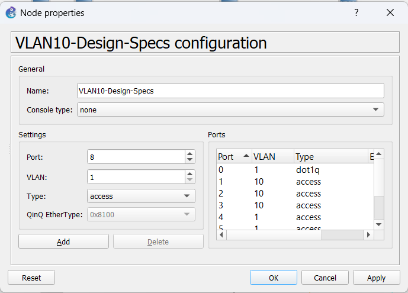
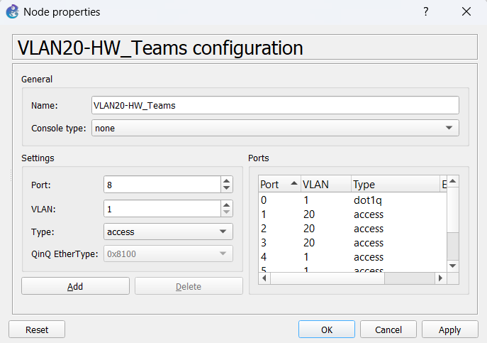
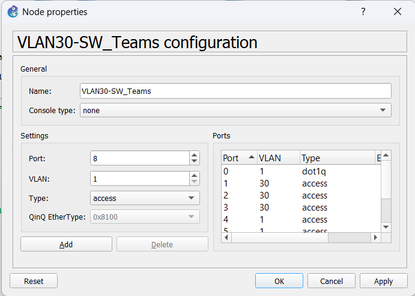
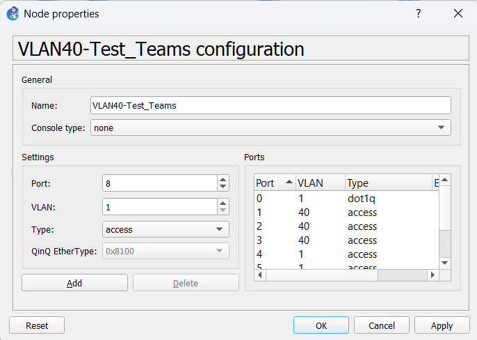
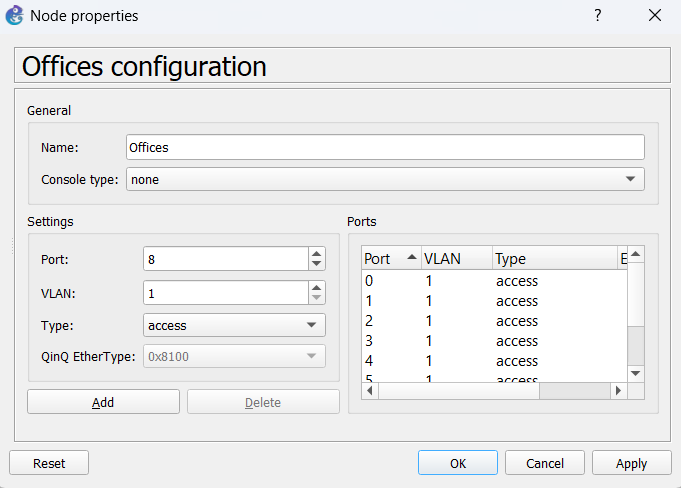
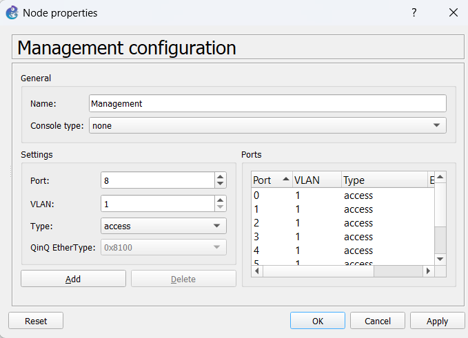
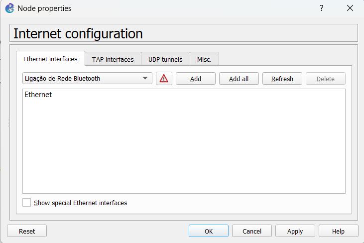
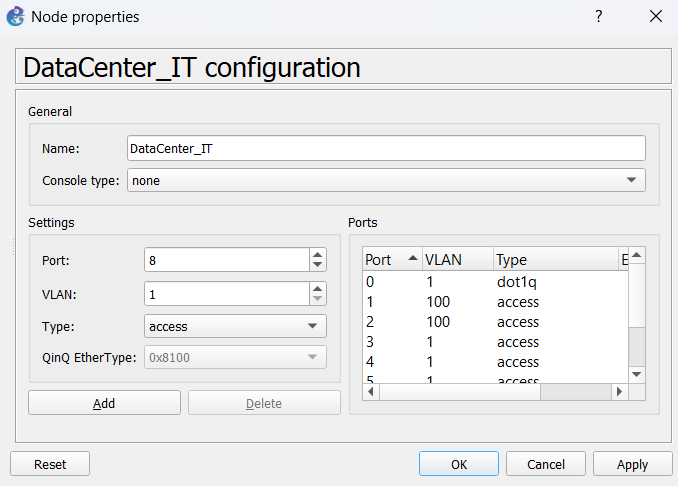

# Advanced Enterprise Network Routing & Switching Project

## Project Overview

This project involved the design, configuration and implementation of an enterprise network infrastructure using GNS3 and Cisco network devices.

The network integrates IPv4 and IPv6 environments, dynamic routing protocols, VLAN segmentation, inter-VLAN communication and essential network services such as DHCP, DHCP Relay and Network Address Translation (NAT).

The main objective was to establish communication between different network segments while ensuring proper IP addressing, routing and connectivity across the entire infrastructure.

### Network Topology Components

- **3x Cisco 7200 Routers:** `BGI1-C7200`, `BGI2-C7200` and `BGI3-C7200`.
- **1x Multilayer/EtherSwitch Router:** `BGI-ESW` equipped with an `NM-16ESW` module.
- **End Devices/Clients:** `Bits-Bytes`, `BreakIt` and `CEO`.

### Protocols and Services

- OSPF (IPv4)
- RIPng (IPv6)
- DHCP and DHCP Relay
- NAT Overload (PAT)
- VLAN segmentation
- IEEE 802.1Q VLAN Trunking
- IPv4 and IPv6 dual-stack configuration
## Network Topology and VLANs

### Overall Network Topology

### VLAN Configuration

The network is divided into four VLANs:

| VLAN | Network Segment |
|---|---|
| VLAN 10 | VLAN 10 |
| VLAN 20 | VLAN 20 |
| VLAN 30 | VLAN 30 |
| VLAN 40 | VLAN 40 |

### Network Segments

The following diagrams illustrate the different network areas and infrastructure components.

## 1. Infrastructure and Device Configuration

### A. Core and Edge Routing — BGI1-C7200

The `BGI1-C7200` router acts as the primary edge router, providing centralized DHCP and NAT services.

**DHCP Configuration**
- Configured DHCP pools to dynamically assign IPv4 addresses to different local subnets.
- Address ranges include networks such as `172.21.122.0/24` and `172.21.123.0/25`.

**NAT Overload (PAT)**
- Implemented NAT Overload to allow multiple internal devices to share translated external IP addresses.
- Configured an external address pool ranging from `201.122.183.129` to `201.122.183.158`.
- Used Access Control List (ACL) 2 to define the addresses subject to translation.

**Dynamic Routing**
- Configured multiple OSPF routing processes.
- Implemented IPv6 RIP (`proc1`) across serial and FastEthernet interfaces.

### B. Distribution and Switching — BGI-ESW

The `BGI-ESW` device uses an `NM-16ESW` EtherSwitch module to provide Layer 2 switching capabilities, together with Layer 3 VLAN interfaces (SVIs).

**VLAN Configuration**

The network is segmented into multiple VLANs:

| VLAN | IPv4 Address | IPv6 Address |
|---|---|---|
| VLAN 10 | `172.21.123.238/28` | `2002:A133:B882:10::1/64` |
| VLAN 20 | `172.21.123.126/25` | `2002:A133:B882:20::1/64` |
| VLAN 30 | `172.21.122.254/24` | `2002:A133:B882:30::1/64` |
| VLAN 40 | `172.21.123.222/27` | `2002:A133:B882:40::1/64` |

**DHCP Relay**

- Configured `ip helper-address` on the VLAN interfaces.
- Forwarded DHCP discovery requests to the centralized DHCP server hosted on `BGI1-C7200`.

### C. Secondary Routers — BGI2-C7200 and BGI3-C7200

**BGI2-C7200**
- Manages additional LAN segments.
- Configures loopback and secondary IP addressing on FastEthernet interfaces.
- Participates in OSPF Area 28.

**BGI3-C7200**
- Implements router subinterfaces on `FastEthernet2/0.2` and `FastEthernet2/0.3`.
- Uses IEEE 802.1Q encapsulation.
- Provides routing for VLAN 100 and VLAN 50.

## 2. Key Technical Implementations

**Dynamic Routing**
- Configured OSPF for IPv4 routing across multiple network areas and processes.
- Implemented IPv6 RIP (`proc1`).
- Configured routing integration between the network segments.

**Centralized DHCP Management**
- Implemented DHCP pools on the central router.
- Used DHCP Relay to forward client requests across different broadcast domains.

**Network Address Translation**
- Configured NAT Overload (PAT) to enable internal devices to share external IP addressing.

**Dual-Stack Networking**
- Implemented IPv4 and IPv6 addressing across the network infrastructure.
- Configured IPv6 Global Unicast Addresses using the `2002:A133:B882::/48` prefix.

**VLAN Segmentation**
- Configured multiple VLANs to separate network segments.
- Implemented IEEE 802.1Q encapsulation for VLAN traffic.

## 3. My Contribution

I was responsible for the technical implementation of the project, including the network configuration and integration of the different devices and services.

My contributions included:

- Configuring Cisco routers and switching infrastructure.
- Designing and implementing the network addressing scheme.
- Configuring OSPF and RIPng routing protocols.
- Implementing VLANs and IEEE 802.1Q trunking.
- Configuring DHCP pools and DHCP Relay.
- Implementing NAT Overload (PAT).
- Configuring IPv4 and IPv6 connectivity.
- Troubleshooting network configurations and verifying connectivity between devices.

## 4. Tools and Technologies

- **GNS3** — Network topology design and simulation.
- **Cisco IOS** — Router and network device configuration.
- **OSPF** — Dynamic IPv4 routing.
- **RIPng** — Dynamic IPv6 routing.
- **DHCP / DHCP Relay** — Dynamic IP address assignment.
- **NAT / PAT** — Network address translation.
- **VLAN / IEEE 802.1Q** — Network segmentation and trunking.
- **IPv4 / IPv6** — Network addressing and communication.

## 5. Project Files

This repository includes the configuration files and supporting files used during the network implementation and simulation in GNS3.

- **Router configuration files:** Cisco device configurations (`.cfg`).
- **Virtual PC configuration files:** End-device configurations (`.vpc`).
- **GNS3 project files:** Supporting files used in the network simulation, where available.

## 6. Project Information

- **Course:** Telecommunications Networks
- **Institution:** University of Aveiro
- **Academic Year:** 2023/2024
- **Author:** Adriana Pires
- **Degree:** Bachelor's in Electrical and Computer Engineering

---

*University of Aveiro — Portugal*
